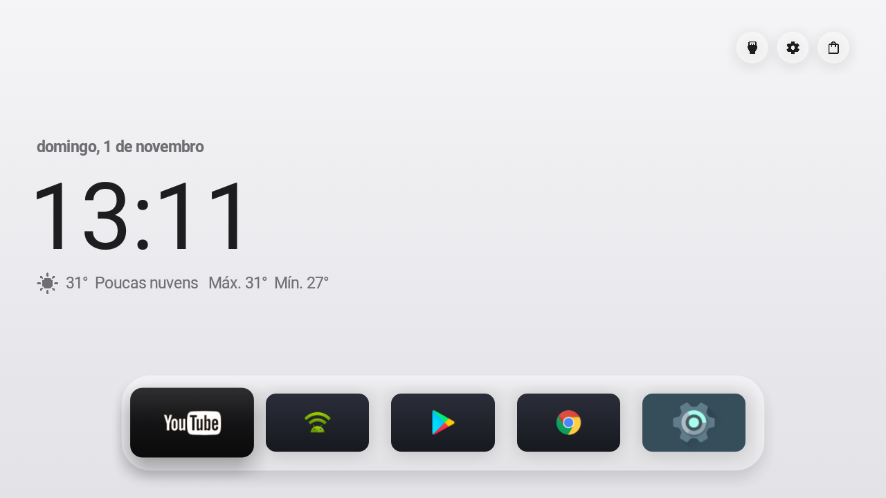

# TX9 (Amlogic p281) — a build do Free My TV para essa box

Esta pasta é a **build e as notas da TV box TX9** do usuário (`192.168.0.232`): o APK que está
instalado nela, o script que o recompila e o que foi preciso mudar no app para ele rodar.

O projeto (Free My TV) não conhece essa box: ele foi feito para Google TV / Android TV **8 ou
nover**, com `leanback`. A TX9 é uma box Android com launcher de TV, mas **Android 7.1.2** e sem
`leanback`. As mudanças abaixo vivem no repositório, **sem commit** — o padrão do projeto continua
Android 8+ (veja *Reverter*).

## O aparelho

| | |
|---|---|
| Modelo | TX9 (Amlogic p281), Android TV-like, `com.oranth.launcher` + `com.android.tv.settings` |
| IP | `192.168.0.232` (Wi-Fi `wlan0`), fuso `America/Recife` → a cidade vem do fuso no build `--generic` |
| Android | **7.1.2 (API 25)** — apesar de se anunciar como "8.1.0" |
| Root | `adb shell` roda como root (`ro.debuggable=1`), `ro.adb.secure=0` |
| ADB | `adbd` na 5555, **atende um cliente por vez** |

### Como se descobriu o Android real

O `ro.build.version.release` dizia `8.1.0`, mas `ro.build.version.sdk` era `25` — e o instalador
recusava o APK (*`Requires newer sdk version #26 (current version is #25)`*). O que confirmou:

- `ro.build.version.sdk` = **25** (o Android 8.1 lê o SDK dessa propriedade, então o sistema se
  acha API 25);
- `com.android.systemui` e `com.android.phone` = versão **7.1.2**; `com.android.settings` = 8.1.0;
- sem o serviço `overlay` e sem `vibrator_manager` (só existem no Android 8+);
- `APP_NOTIFICATION_SETTINGS` (API 26) não resolve nenhuma activity;
- `cmd role` (Android 9+) não existe; `cmd uimode` (8+) também não.

O "8.1.0" no fingerprint, no `display.id` e no patch de segurança (2017-12-01) é string do
fabricante, não do sistema.

## O APK

| | |
|---|---|
| Arquivo | `FreeMyTV-tx9.apk` (1,6 MB) — a mesma build (mesmo código, mesma chave) que está instalada na box |
| SHA-256 | `42A750CA5C9E2441ADE392E4928358D7A3D3EBA80E26C1D3443F9DB6FF512E7A` (o APK é recompilado a cada vez; o que importa para a TV é o certificado abaixo) |
| Assinatura | `CN=Free My TV`, SHA-256 `4d395e7728d8554f93055db6de24a909a3eba39fdedbec1669fce90e2aeb516d` |
| Chave | `freemytv.keystore` na raiz do projeto (senha `freemytv`, alias `freemytv`) |
| Build | `./build.sh --generic --min-sdk=25` (sem `config.properties`: sem chave do TMDB, cidade pelo fuso) |

A chave é **local**, não a de release do projeto (`b85d4ff6…`). Consequências: o app **não se
atualiza sozinho** pelas releases do GitHub, e instalar uma release oficial exigiria desinstalar
antes (assinatura diferente). Para atualizar esta box, recompile e reinstale com a **mesma**
`freemytv.keystore`.

`*.apk` e `*.keystore` estão no `.gitignore`: a pasta entra no git só com o texto e a imagem.

## Recompilar

```bash
./tx9/build-tx9.sh              # só compila e copia para tx9/FreeMyTV-tx9.apk
./tx9/build-tx9.sh --install    # compila, instala na box e solta a conexão
```

Duas particularidades desta máquina, já resolvidas no script:

1. **Caminhos Windows no Git Bash.** Com caminhos POSIX (`/c/Users/...`), o Git Bash reescreve o
   `-bootclasspath` do javac e os *lambda stubs* somem: `cannot find symbol: method metafactory`.
   Com `C:/Users/...` funciona.
2. **JDK 17.** O `d8` 8.2.2 (build-tools 34.0.0) não lê as classes que o javac do JDK 21 escreve
   (`NullPointerException` em `DreamView$1.class`). O JDK 17 está em
   `C:\Users\Fabio\AppData\Local\Android\jdk17\jdk-17.0.20.1+1`, e o SDK isolado com
   build-tools 34.0.0 + platform android-34 (o do CI) em
   `C:\Users\Fabio\AppData\Local\Android\Sdk34`.

## Antes de trocar de modo: solte o computador

O `adbd` dessa box **atende um cliente por vez**. Com o `adb` do PC conectado, o app não consegue
falar com o ADB dela e a troca falha com *"o ADB da TV não respondeu"* (é o caso #221 do projeto).

```bash
adb disconnect 192.168.0.232:5555
adb kill-server
```

Depois é só apertar na TV: **Free My TV → Início → Free My TV**. Para vigiar o que a TV registrou,
o logcat pode rodar **dentro** da box (o `adb` do PC ocuparia a vaga):

```bash
adb shell "nohup logcat -v time -s FreeMyTV > /sdcard/fm.log 2>&1 &"
# ... a pessoa troca de modo na TV ...
adb connect 192.168.0.232:5555 && adb pull /sdcard/fm.log
```

## O boot: a tela inicial não subia sozinha

Ao ligar a box depois de um desligamento, a ROM dela subia **o launcher dela** (o `com.oranth.launcher`,
que o Free My TV desliga ✗) e a tela inicial do Free My TV não aparecia: era preciso abrir pelo menu de
aplicativos.

Duas coisas no projeto foram a causa:

1. A linha **Ao ligar** estava travada nesta box (*Indisponível* ✗): ela exigia Live TV para a linha
   inteira ✗, e esta box não tem tuner ✗ — mas a opção *"Início"* não precisa de tuner ✗. Agora só o
   valor *"Live TV"* exige ✗, e os outros dois são os que a linha oferece ✓.
2. Em **Ao ligar → Início**, o app só devolvia a tela quando um app de Live TV tomava a frente ✗ — e
   nunca *começava* a nossa ✗. Agora, quando a nossa tela não sobe (a box mostrou a dela ✗) e ninguém
   mexeu no controle há um tempo (o boot da box conta como "alguém mexeu" ✗, por isso a espera), a nossa
   toma a tela ✓.

O log depois do boot:

```
at power-on: our home screen wasn't up (com.oranth.launcher), bringing it up
```

> **Ao testar isso, o `adb` do computador atrapalha**: o `adbd` da box atende **um cliente por vez** ✗,
> e o `adb` do PC (que reconecta sozinho ✗) toma a vaga ✗ — aí o app não consegue falar com a TV ✗ e o
> boot check falha com *"o ADB da TV não respondeu"* ✗. Para testar o boot, mande `adb reboot` e **mate o
> servidor adb do PC** (`adb kill-server`) logo depois ✗, e só reconecte depois de um minuto ✗.

## O que mudou no app (12 arquivos, sem commit)

| Arquivo | Mudança | Motivo |
|---|---|---|
| `build.sh` | flag `--min-sdk=N` (padrão 26) | compilar para Android 7 sem baixar o piso do projeto |
| `Ui.java` | `Ui.join()`; `Typeface.Builder` isolado em classe aninhada | `String.join` e `Typeface.Builder` são API 26/28 |
| `HomeMode.java` | `Ui.join()`; `androidTv()` reconhece `com.android.tv.settings` | box sem `leanback` era tomada como celular |
| `Recs.java` | `Ui.join()` | `String.join` é API 26 |
| `KeyPage.java` | `android.util.Base64` | `java.util.Base64` é API 26 |
| `Secrets.java` | leitura por stream | `java.nio.file` é API 26 |
| `SleepOverlay.java` | canal de notificação isolado; `startService` no 7; `TYPE_SYSTEM_ALERT` | API 26 |
| `HomeApps.java` | `AdaptiveIconDrawable` isolado | API 26 |
| `Backdrop.java` | `Bitmap.Config.HARDWARE` isolado | API 26 |
| `HomeView.java` | `registerDefaultNetworkCallback` sem handler no 7 | a sobrecarga com handler é API 26 |
| `WatchNext.java` | Continue Watching vazio no 7 | `TvContract` é API 26 |
| `ScreenBlur.java` | sem desfocar no 7 | `PixelCopy` de janela é API 26 |

O padrão do projeto (isolar a API nova numa classe aninhada, como `Recording.Node` e `Ui.Weighted`)
foi mantido: as classes antigas ainda verificam no Android 7.

### Reverter

```bash
git checkout -- app/src build.sh
```

Volta o projeto ao estado original (Android 8+). O APK desta box continua instalado nela, mas uma
recompilação normal já não atualiza: assinatura e `minSdk` diferentes.

## O que não funciona (e está previsto)

| Recurso | Por quê |
|---|---|
| Vidro com AGSL (céu, reflexo) | AGSL é Android 13+; a box usa o gradiente plano (*"shader unavailable, using gradient"* no log) |
| Fundo desfocado (vidro da tela) | `PixelCopy` de janela é API 26; a box usa o véu escuro |
| Continue Watching | `TvContract` é API 26; a lista fica vazia |
| Fontes variáveis (Inter com peso) | `Typeface.Builder` é API 28; a box usa a fonte do sistema |
| "Latest apps" com `ps -A -o NAME` | funciona, mas `pm list packages -d` e afins são do Android 7 |

## Checklist

```bash
adb connect 192.168.0.232:5555
adb shell "cmd package query-activities --brief --user 0 -a android.intent.action.MAIN -c android.intent.category.HOME"
# deve listar io.freemytv/.HomeActivity
adb shell settings get secure screensaver_components    # io.freemytv/io.freemytv.Screensaver
adb shell "dumpsys package com.oranth.launcher | grep enabled="   # enabled=0 (desligado, não removido)
adb shell input keyevent 3      # Home: tem de abrir o Free My TV
```



## Ideias para o futuro

Espaço para as melhorias que você quer fazer no projeto a partir daqui — anote aqui ou me conte
na conversa e eu implemento.

### 1. Escolher a imagem de fundo (tela inicial e tela de descanso) — **feito**

*Home Settings* → **Wallpaper** (*Papel de parede*) e **Screensaver photo** (*Foto da tela de
descanso*): o OK abre as fotos (a que está em foco aparece grande, ao lado da lista) e as setas
passam por elas uma a uma. *Automático* volta ao comportamento de antes.

O que mudou no app:

| Onde | O quê |
|---|---|
| `Prefs` | `wallpaper()` e `saverPhoto()` (o nome do arquivo; vazio = automático) |
| `Photos` | `chosen()` (o arquivo escolhido), `chosenPick()` (a foto sozinha na tela de descanso) e `backdrop()` que passa a devolver a escolhida antes da da hora |
| `HomeView` | `backgroundFor()`: a foto escolhida ganha dos destaques (e o fundo não segue mais o card em foco) |
| `DreamView` | `photos()`: a foto escolhida, sozinha, com o zoom lento de sempre |
| `SettingsActivity` | As duas linhas novas, o seletor (com a prévia grande, lida em segundo plano) e a renumeração das linhas |

Traduções: "Wallpaper" e "Screensaver photo" nos 26 catálogos, à mão.

**A primeira foto na TX9**: `tools/photos.py` enviou três fotos de teste; para ver a sua,
envie as suas (`python3 tools/photos.py 192.168.0.232 foto.jpg`) e escolha na TV.

### 2. (a seguir)

-
